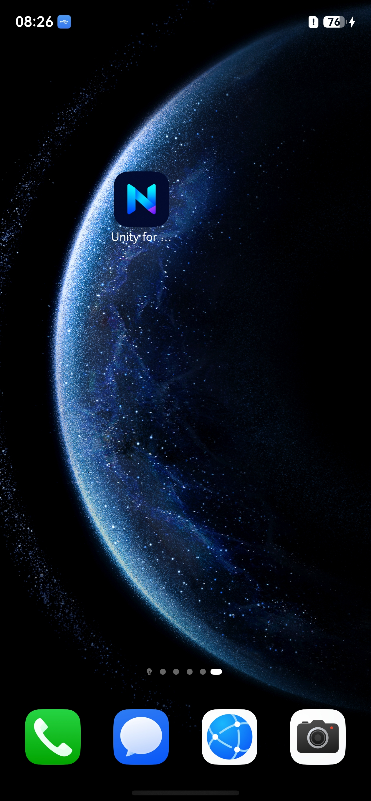
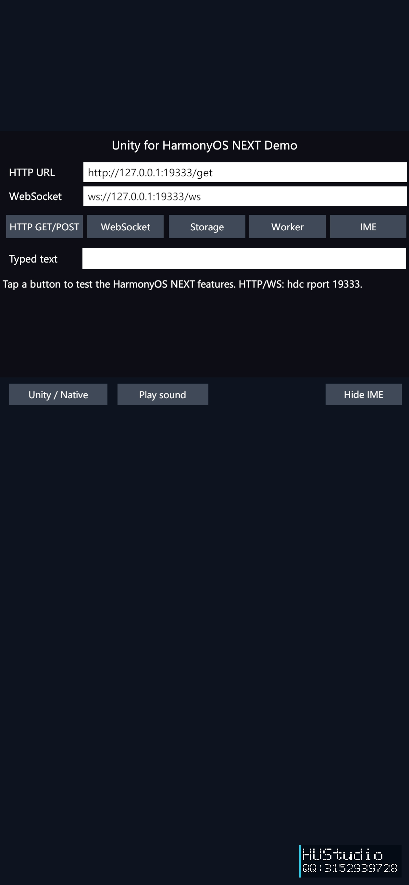

# HUStudio HarmonyOS Unity SDK

Unity 的 HarmonyOS 导出插件。先检测 DevEco 环境，再构建 WebGL，最后导出 DevEco 工程或 HAP。  
Unity HarmonyOS exporter. Check DevEco, build WebGL, then export a DevEco project or HAP.

## 效果预览 / Preview

| 设备桌面 / Device home screen | Quick Start 示例 / Quick Start demo |
| :---: | :---: |
|  |  |

- [中文说明](README.zh-CN.md) · [English README](README.en.md)
- [中文安装与使用教程](Documentation~/GettingStarted.zh-CN.md) · [English installation and usage guide](Documentation~/GettingStarted.en.md)
- [中文授权协议](LICENSE.zh-CN.md) · [English license](LICENSE.en.md)

免费使用，包括保留水印的商业项目；去除水印须取得单独的书面商业授权。  
Free use, including commercial projects, is allowed with the watermark retained. A separate written commercial license is required to remove it.

使用咨询 / inquiries: **QQ: 3152939728**.
